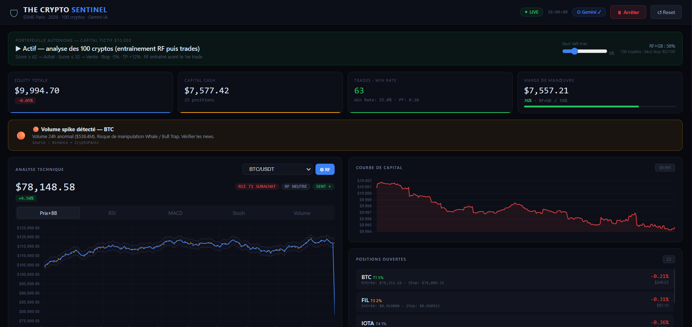

# 🛡 The Crypto Sentinel

Outil d'aide à la décision pour le trading de cryptomonnaies, développé dans le cadre d'un projet de gestion de portefeuille à l'**ESME Paris** (2026), par **Tanguy Jean-Baptiste** et **Augustin Boisseuil**.

L'application suit **100 cryptomonnaies en temps réel** (Binance), calcule un score de décision sur 100 pour chacune et gère un **portefeuille fictif de 10 000 $** en simulation (paper trading). Aucun ordre réel n'est passé.



## Fonctionnement

Chaque actif reçoit un score de 0 à 100 qui combine :

| Composante | Poids |
|---|---|
| Modèle de machine learning (Random Forest + Gradient Boosting) | 30 |
| RSI | 15 |
| MACD | 15 |
| ADX | 10 |
| Bandes de Bollinger | 10 |
| Sentiment des news (CryptoPanic) | 10 |
| Stochastique | 5 |
| Volume | 5 |

- **Score ≥ 62** : signal d'achat · **Score ≤ 32** : signal de vente
- **Allocation par paliers de liquidité** : 5 % du capital par actif pour le top 10, puis 3 %, 2 % et 1 %
- **Garde-fous de risque** : VaR et CVaR 24 h, ratio de Sortino, max drawdown, stop loss fixe, ATR et trailing, take profit à +12 %
- **Synthèse en langage naturel** de chaque analyse via l'API Gemini (optionnelle)

## Résultats du backtest

| | The Crypto Sentinel | Achat-conservation BTC |
|---|---|---|
| Rendement | 38,5 % | 61,7 % |
| Ratio de Sortino | **3,83** | 1,93 |

La stratégie rapporte moins que la simple détention du Bitcoin sur la période testée, mais avec un rendement ajusté du risque baissier deux fois meilleur.

## Installation

```bash
pip install -r requirements.txt
cp .env.example .env   # puis renseigner les clés (facultatif)
python backend.py
```

Ouvrir ensuite http://localhost:5000.

Les clés d'API sont facultatives : sans clé CryptoPanic, le sentiment passe en mode démo ; sans clé Gemini, une synthèse locale est affichée à la place.

## Stack

Python · Flask · pandas · NumPy · scikit-learn · API Binance · API CryptoPanic · Google Gemini · Chart.js

---

*Projet académique, à but pédagogique uniquement. Ceci n'est pas un conseil en investissement.*
